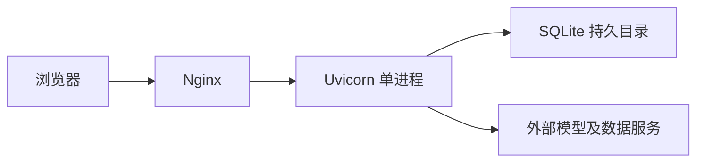

## 第1章 部署范围

目标为华为云 Debian 实例 `139.9.140.227`，2 核、2 GiB 内存。配置模板已准备；服务器尚未登录，不能视为已上线。

| 项目 | 配置 | 目的 | 验收条件 |
|---|---|---|---|
| 应用 | Python 3.11 或 3.12、单 Uvicorn 进程 | 控制内存；进程内个人模型配置保持一致 | 健康接口返回 200 |
| 数据 | `/var/lib/prism/prism.sqlite3` | 与源码隔离持久化 | 重启后账户仍存在 |
| 网关 | Nginx，应用仅监听回环地址 | 转发请求及限制认证频率 | 登录页与流式响应正常 |
| 进程管理 | systemd、非 root 账户 | 自动重启及开机启动 | 服务状态 active |

原生 systemd 方案比在当前小内存实例上额外引入容器管理更直接。暂不安装可选的本地向量模型及 PostgreSQL。未配置供应商凭据的能力仍按项目规则显示不可用。



## 第2章 首次安装

先检查服务器现有服务、监听端口、Debian 版本和剩余磁盘，避免覆盖已有站点。以下操作以管理员身份执行，仅适用于确认空闲的目标目录。Python 必须为 3.11 或 3.12；若 Debian 默认版本不同，先单独安装兼容版本。

```bash
apt-get update
apt-get install -y python3 python3-venv git nginx curl
python3 --version
useradd --system --home-dir /var/lib/prism --shell /usr/sbin/nologin prism
install -d -m 700 -o prism -g prism /var/lib/prism
install -d -m 700 /etc/prism
git clone https://github.com/1917173927/prism.git /opt/prism
cd /opt/prism
# 部署前记录并核对已经通过测试的提交。
git rev-parse HEAD
python3 -m venv .venv
.venv/bin/python -m pip install '.[web]'
install -m 600 /dev/null /etc/prism/prism.env
# 使用编辑器填写服务端供应商配置；禁止将本机账户库或密钥文件上传到仓库。
editor /etc/prism/prism.env
install -m 644 deploy/huawei/prism.service /etc/systemd/system/prism.service
systemctl daemon-reload
systemctl enable --now prism
curl --fail http://127.0.0.1:8000/api/health
install -m 644 deploy/huawei/prism.nginx.conf /etc/nginx/sites-available/prism
ln -s /etc/nginx/sites-available/prism /etc/nginx/sites-enabled/prism
nginx -t
systemctl reload nginx
```

环境配置采用 `名称=值`，不使用 shell 命令。Linux 网页保存的个人模型密钥仅在当前进程有效，持久化默认凭据通过受限环境文件提供。`PRISM_DEV_NO_AUTH=false` 由服务配置强制设置。

## 第3章 网络与验收

SSH 端口仅向维护来源开放；HTTP 模板用于初始连通性验证。提供域名并配置有效 HTTPS 后，再通过公网登录或填写凭据。没有 HTTPS 时，可使用 SSH 隧道访问 `http://127.0.0.1:8000` 完成私有验收。不要直接对公网开放应用端口 8000。

检查 `systemctl status prism`、`journalctl -u prism`、健康接口及登录重定向。完成注册、退出、重新登录和重启持久化检查后，才可判定部署成功。网页可访问不代表实时行情或模型服务可用；供应商能力需单独验证。

## 第4章 更新与恢复

更新前记录 `git rev-parse HEAD`，使用 `tools/database_backup.py` 的在线备份命令备份 SQLite 至新的受限文件，并单独保存环境配置。停止服务后更新至已验证提交，重新安装依赖，再启动和验收。应用失败时恢复先前提交；数据库迁移不支持自动降级，应保留现场数据，将备份恢复至新路径并人工核对后切换。禁止直接覆盖现有数据库。
